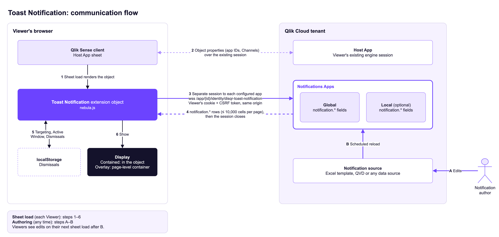

# Toast Notification

A Qlik Sense extension that shows **Notifications** to people using your Qlik apps: data quality alerts, new features, planned outages. You write Notifications in one place, a **Notifications App**. Every app with the extension picks them up the next time someone opens the sheet. Everything stays inside Qlik, with no external service, no web integration and no tenant security-policy (CSP) changes.

- Plain text or basic Markdown
- Four Severities: `info`, `success`, `warning`, `critical`
- Targeting by **Channel** (e.g. `sales`, or `all`) or by specific app IDs
- Start and end times (UTC)
- Viewers can dismiss a Notification, and it comes back if you edit it
- Floats over the sheet (Overlay, the default) or sits inside the object on the sheet (Contained)

Built on [nebula.js](https://qlik.dev/extend/extensions/nebula-js/) and follows Qlik's [extension guidelines](https://qlik.dev/extend/extensions/extension-guidelines/).

> **Status:** v0.1, Qlik Cloud. Qlik Sense Client-Managed should work but has not been tested yet.

## How it works



<sub>Source: [`docs/diagrams/communication-flow.drawio`](docs/diagrams/communication-flow.drawio). Edit it in draw.io and re-export the PNG.</sub>

Each extension object can read a **Global** Notifications App (tenant-wide) and a **Local** one (for a team or space). It opens a separate, short-lived session to each app, reads the Notifications Table, and closes the session. It never changes selections in the app you're using. See [ADR-0001](docs/adr/0001-live-notifications-app.md) for why it works this way.

## Setup

1. **Create a Notifications App** in a space that your Viewers can at least view.
   - Quick test: paste [`templates/notifications-app-inline.qvs`](templates/notifications-app-inline.qvs) into the load script and reload.
   - Real use: upload [`templates/notifications-template.xlsx`](templates/notifications-template.xlsx) to the space. Use [`templates/notifications-app-excel.qvs`](templates/notifications-app-excel.qvs) as the load script, and schedule a frequent reload.
2. **Install the extension.** Download the zip from [Releases](https://github.com/disqr/qlik-toast-notification/releases) (or build it, see below) and upload it in the Management Console → **Extensions**.
3. **Add it to a sheet.** In a Host App, open Custom objects → **DI Squared** and drag **Toast Notification** onto a sheet. Then set:
   - **Global Notifications App ID** and/or **Local Notifications App ID**. Pasting the app's URL works too.
   - **Channels** this app subscribes to, e.g. `sales, emea`. Every object also receives `all`.

## Setup on many sheets

An extension runs only while its object is on the open sheet, so each sheet that should show Notifications needs the object. Qlik offers no supported way for an extension to run without a sheet object. Extensions that take up no space do it by hiding Qlik's own grid cells or editing Qlik's menus, which Qlik's [extension guidelines](https://qlik.dev/extend/extensions/extension-guidelines/) rule out. To keep the footprint small:

1. **Use Overlay mode** (the default). Viewers never see the object; the Notifications float over the sheet.
2. **Make the object as small as the grid allows** and tuck it into a corner. Titles are off by default.
3. **Hide what's left.** If your theme gives objects a background or border, turn them off under the object's Appearance settings, and turn off the hover menu if your tenant offers that option.
4. **Configure it once.** Set up one object, then right-click it and choose **Add to master items**. Drag the master item onto each sheet. Changes to the master item apply everywhere it's used.

## Notifications Table

The extension reads these fields from a Notifications App. Load them however you like, but keep them in **one table**.

| Field | Required | Meaning |
|---|---|---|
| `notification.id` | ✔ | Unique within its Notifications App |
| `notification.title` | ✔ | |
| `notification.body` | ✔ | Plain text, or Markdown when `format` is `markdown` |
| `notification.format` | | `text` (default) or `markdown` |
| `notification.severity` | ✔ | `info`, `success`, `warning` or `critical` |
| `notification.category` | | Free label, e.g. `Data quality` |
| `notification.start_utc` | ✔ | UTC. ISO text (`2026-03-01T06:00:00Z`) or a date/timestamp |
| `notification.end_utc` | | UTC. Blank means it never expires |
| `notification.channel` | one of | One Channel. `all` reaches every Host App |
| `notification.target_app_ids` | one of | Comma-separated app IDs (pasted URLs work) |
| `notification.link_url` | | `http(s)` link |
| `notification.link_label` | | Link text |

A Notification has **either** a Channel **or** Target App IDs, never both. Rows that break a rule are skipped. Developers see how many were skipped, and why, while editing the sheet. Extra fields are ignored.

## Behavior

- **Order:** most severe first, then the newest. The top Notification is shown with a "+N more" link.
- **Dismissal:** a dismissed Notification stays hidden in that browser until it is edited. A `critical` Notification comes back on the next sheet load.
- **Overlay (default):** the Notifications float above the sheet in a corner of the browser window, bottom-right by default, and the object itself stays empty. You can change the distance from the edges to clear Qlik's bars. `info` and `success` hide themselves after 8 seconds, which doesn't count as a Dismissal. See [ADR-0002](docs/adr/0002-overlay-portal.md).
- **Errors:** if a Notifications App can't be read (no access, wrong ID, missing fields), Viewers see nothing. Developers see the reason in edit mode.
- **Colors:** fonts and background come from the app theme. Severity colors have accessible defaults that you can change under Severity colors.

## Things to know

- **Licensing:** each sheet load briefly opens each configured Notifications App. On tenants licensed by **Analyzer Capacity**, that counts as extra app opens. Capacity-based subscriptions have no per-app-open meter.
- **Access:** Viewers need at least view access to each Notifications App's space. Without it, they see no Notifications from that app.
- **Freshness:** edit the source → reload the Notifications App → Viewers see the change on their next sheet load.

## Development

Requires Node 24.

```sh
npm install
npm test          # domain tests (node:test)
npm run build     # dist/
npm run package   # release/disqr-toast-notification-<version>.zip, ready to upload
```

- Domain language: [`CONTEXT.md`](CONTEXT.md)
- Decisions: [`docs/adr/`](docs/adr/)

## License

[MIT](LICENSE) © 2026 DI Squared LLC
